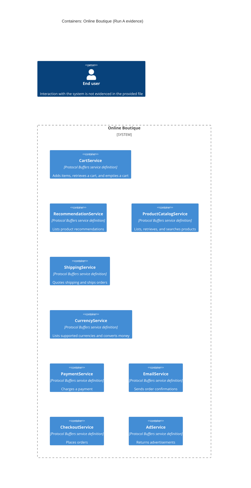

# Recovered architecture (Run A)

## Agent

GitHub Copilot (Copilot SDK in VS Code); model: not exposed.

## Files read

- `AGENTS.md`
- `prompts/1-recover-architecture.md`
- `system/online-boutique/protos/demo.proto`

## Containers table

| Name | Technology/language | Responsibility | Evidence |
|---|---|---|---|
| CartService | Protocol Buffers service definition; implementation technology not evidenced | Adds items, returns a user's cart, and empties a user's cart (`CartService` RPCs) | `system/online-boutique/protos/demo.proto` (`CartService`) |
| RecommendationService | Protocol Buffers service definition; implementation technology not evidenced | Lists product recommendations (`RecommendationService.ListRecommendations`) | `system/online-boutique/protos/demo.proto` (`RecommendationService`) |
| ProductCatalogService | Protocol Buffers service definition; implementation technology not evidenced | Lists, retrieves, and searches products (`ProductCatalogService` RPCs) | `system/online-boutique/protos/demo.proto` (`ProductCatalogService`) |
| ShippingService | Protocol Buffers service definition; implementation technology not evidenced | Quotes shipping and ships orders (`ShippingService` RPCs) | `system/online-boutique/protos/demo.proto` (`ShippingService`) |
| CurrencyService | Protocol Buffers service definition; implementation technology not evidenced | Lists supported currencies and converts money (`CurrencyService` RPCs) | `system/online-boutique/protos/demo.proto` (`CurrencyService`) |
| PaymentService | Protocol Buffers service definition; implementation technology not evidenced | Charges a payment (`PaymentService.Charge`) | `system/online-boutique/protos/demo.proto` (`PaymentService`) |
| EmailService | Protocol Buffers service definition; implementation technology not evidenced | Sends order confirmations (`EmailService.SendOrderConfirmation`) | `system/online-boutique/protos/demo.proto` (`EmailService`) |
| CheckoutService | Protocol Buffers service definition; implementation technology not evidenced | Places orders (`CheckoutService.PlaceOrder`) | `system/online-boutique/protos/demo.proto` (`CheckoutService`) |
| AdService | Protocol Buffers service definition; implementation technology not evidenced | Returns advertisements (`AdService.GetAds`) | `system/online-boutique/protos/demo.proto` (`AdService`) |

## Dependencies table

No runtime caller-to-callee dependencies are evidenced in the provided file. It declares service RPC interfaces, but does not show which component calls any service.

| Caller → callee | Protocol | Evidence |
|---|---|---|
| None evidenced | Not evidenced | `system/online-boutique/protos/demo.proto` declares service RPCs but no caller relationships |

## Mermaid diagram

## Gaps

- The implementation language and runtime technology of each service are not evidenced; service implementation files or deployment manifests would settle this.
- Which service calls which other service, and the protocol used for those runtime calls, are not evidenced; service call-site code or runtime configuration would settle this.
- The end user's interaction with the system is not evidenced; frontend or ingress configuration would settle this.
- Data stores, message brokers, external systems, and their relationships to these services are not evidenced; service implementation and deployment configuration would settle this.
