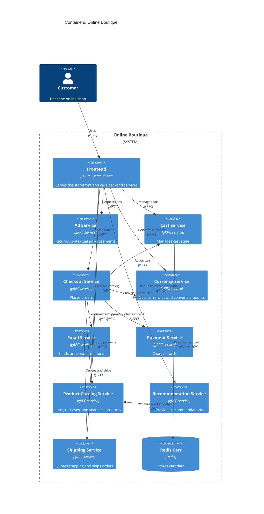

# Online Boutique C4 Container Architecture

## Agent

AI assistant using Copilot SDK in VS Code; model not disclosed.

## Files read

- `system/online-boutique/protos/demo.proto`
- `system/online-boutique/kubernetes-manifests/README.md`
- `system/online-boutique/kubernetes-manifests/adservice.yaml`
- `system/online-boutique/kubernetes-manifests/cartservice.yaml`
- `system/online-boutique/kubernetes-manifests/checkoutservice.yaml`
- `system/online-boutique/kubernetes-manifests/currencyservice.yaml`
- `system/online-boutique/kubernetes-manifests/emailservice.yaml`
- `system/online-boutique/kubernetes-manifests/frontend.yaml`
- `system/online-boutique/kubernetes-manifests/kustomization.yaml`
- `system/online-boutique/kubernetes-manifests/loadgenerator.yaml`
- `system/online-boutique/kubernetes-manifests/paymentservice.yaml`
- `system/online-boutique/kubernetes-manifests/productcatalogservice.yaml`
- `system/online-boutique/kubernetes-manifests/recommendationservice.yaml`
- `system/online-boutique/kubernetes-manifests/shippingservice.yaml`

## Containers table

| Name | Technology/language | Responsibility | Evidence |
|---|---|---|---|
| Frontend | Containerized web app; HTTP on port 8080 | Serves the storefront and calls backend services | `system/online-boutique/kubernetes-manifests/frontend.yaml` — `containerPort: 8080`, `frontend-external` Service, and env vars such as `PRODUCT_CATALOG_SERVICE_ADDR` |
| Ad Service | gRPC service (language not stated in manifests) | Returns advertisements to the storefront | `system/online-boutique/kubernetes-manifests/adservice.yaml` — Deployment and Service on port 9555 |
| Cart Service | gRPC service (language not stated in manifests) | Adds, gets, and empties a cart | `system/online-boutique/kubernetes-manifests/cartservice.yaml` — Deployment and Service on port 7070 |
| Checkout Service | gRPC service (language not stated in manifests) | Performs order checkout and orchestration | `system/online-boutique/kubernetes-manifests/checkoutservice.yaml` — Deployment and Service on port 5050 |
| Currency Service | gRPC service (language not stated in manifests) | Lists currencies and converts money amounts | `system/online-boutique/kubernetes-manifests/currencyservice.yaml` — Deployment and Service on port 7000 |
| Email Service | gRPC service (language not stated in manifests) | Sends order confirmation emails | `system/online-boutique/kubernetes-manifests/emailservice.yaml` — Deployment and Service on port 5000 (mapped from container port 8080) |
| Payment Service | gRPC service (language not stated in manifests) | Charges the customer credit card | `system/online-boutique/kubernetes-manifests/paymentservice.yaml` — Deployment and Service on port 50051 |
| Product Catalog Service | gRPC service (language not stated in manifests) | Lists, retrieves, and searches product catalog entries | `system/online-boutique/kubernetes-manifests/productcatalogservice.yaml` — Deployment and Service on port 3550 |
| Recommendation Service | gRPC service (language not stated in manifests) | Produces product recommendations | `system/online-boutique/kubernetes-manifests/recommendationservice.yaml` — Deployment and Service on port 8080 |
| Shipping Service | gRPC service (language not stated in manifests) | Quotes shipping and ships orders | `system/online-boutique/kubernetes-manifests/shippingservice.yaml` — Deployment and Service on port 50051 |
| Redis Cart | Redis (`redis:alpine`) | Stores cart state | `system/online-boutique/kubernetes-manifests/cartservice.yaml` — `redis-cart` Deployment and Service on port 6379 |

## Dependencies table

| Caller → callee | Protocol | Evidence |
|---|---|---|
| End user → Frontend | HTTP | `system/online-boutique/kubernetes-manifests/frontend.yaml` — `frontend-external` LoadBalancer Service and `containerPort: 8080` |
| Frontend → Ad Service | gRPC | `system/online-boutique/kubernetes-manifests/frontend.yaml` — `AD_SERVICE_ADDR: "adservice:9555"`; `system/online-boutique/kubernetes-manifests/adservice.yaml` — Service port 9555 |
| Frontend → Cart Service | gRPC | `system/online-boutique/kubernetes-manifests/frontend.yaml` — `CART_SERVICE_ADDR: "cartservice:7070"`; `system/online-boutique/kubernetes-manifests/cartservice.yaml` — Service port 7070 |
| Frontend → Checkout Service | gRPC | `system/online-boutique/kubernetes-manifests/frontend.yaml` — `CHECKOUT_SERVICE_ADDR: "checkoutservice:5050"`; `system/online-boutique/kubernetes-manifests/checkoutservice.yaml` — Service port 5050 |
| Frontend → Currency Service | gRPC | `system/online-boutique/kubernetes-manifests/frontend.yaml` — `CURRENCY_SERVICE_ADDR: "currencyservice:7000"`; `system/online-boutique/kubernetes-manifests/currencyservice.yaml` — Service port 7000 |
| Frontend → Product Catalog Service | gRPC | `system/online-boutique/kubernetes-manifests/frontend.yaml` — `PRODUCT_CATALOG_SERVICE_ADDR: "productcatalogservice:3550"`; `system/online-boutique/kubernetes-manifests/productcatalogservice.yaml` — Service port 3550 |
| Frontend → Recommendation Service | gRPC | `system/online-boutique/kubernetes-manifests/frontend.yaml` — `RECOMMENDATION_SERVICE_ADDR: "recommendationservice:8080"`; `system/online-boutique/kubernetes-manifests/recommendationservice.yaml` — Service port 8080 |
| Frontend → Shipping Service | gRPC | `system/online-boutique/kubernetes-manifests/frontend.yaml` — `SHIPPING_SERVICE_ADDR: "shippingservice:50051"`; `system/online-boutique/kubernetes-manifests/shippingservice.yaml` — Service port 50051 |
| Checkout Service → Cart Service | gRPC | `system/online-boutique/kubernetes-manifests/checkoutservice.yaml` — `CART_SERVICE_ADDR: "cartservice:7070"`; `system/online-boutique/kubernetes-manifests/cartservice.yaml` — Service port 7070 |
| Checkout Service → Currency Service | gRPC | `system/online-boutique/kubernetes-manifests/checkoutservice.yaml` — `CURRENCY_SERVICE_ADDR: "currencyservice:7000"`; `system/online-boutique/kubernetes-manifests/currencyservice.yaml` — Service port 7000 |
| Checkout Service → Email Service | gRPC | `system/online-boutique/kubernetes-manifests/checkoutservice.yaml` — `EMAIL_SERVICE_ADDR: "emailservice:5000"`; `system/online-boutique/kubernetes-manifests/emailservice.yaml` — Service port 5000 |
| Checkout Service → Payment Service | gRPC | `system/online-boutique/kubernetes-manifests/checkoutservice.yaml` — `PAYMENT_SERVICE_ADDR: "paymentservice:50051"`; `system/online-boutique/kubernetes-manifests/paymentservice.yaml` — Service port 50051 |
| Checkout Service → Product Catalog Service | gRPC | `system/online-boutique/kubernetes-manifests/checkoutservice.yaml` — `PRODUCT_CATALOG_SERVICE_ADDR: "productcatalogservice:3550"`; `system/online-boutique/kubernetes-manifests/productcatalogservice.yaml` — Service port 3550 |
| Checkout Service → Shipping Service | gRPC | `system/online-boutique/kubernetes-manifests/checkoutservice.yaml` — `SHIPPING_SERVICE_ADDR: "shippingservice:50051"`; `system/online-boutique/kubernetes-manifests/shippingservice.yaml` — Service port 50051 |
| Recommendation Service → Product Catalog Service | gRPC | `system/online-boutique/kubernetes-manifests/recommendationservice.yaml` — `PRODUCT_CATALOG_SERVICE_ADDR: "productcatalogservice:3550"`; `system/online-boutique/kubernetes-manifests/productcatalogservice.yaml` — Service port 3550 |
| Cart Service → Redis Cart | Redis over TCP | `system/online-boutique/kubernetes-manifests/cartservice.yaml` — `REDIS_ADDR: "redis-cart:6379"`; `system/online-boutique/kubernetes-manifests/cartservice.yaml` — `redis-cart` Service port 6379 |

## Mermaid diagram

## Gaps

- The manifests do not state the implementation language or framework for each service. The source code or build configuration would settle that.
- `system/online-boutique/kubernetes-manifests/frontend.yaml` contains `SHOPPING_ASSISTANT_SERVICE_ADDR: "shoppingassistantservice:80"`, but no matching manifest or service is present in the supplied evidence. It is therefore not included in the architecture above.
- `system/online-boutique/kubernetes-manifests/loadgenerator.yaml` defines a load-generator Deployment, but `system/online-boutique/kubernetes-manifests/kustomization.yaml` comments it out from the active resource set. It is not part of the active runtime architecture shown here.
- The supplied evidence does not identify any external payment processor, email provider, or database beyond the embedded Redis cart store.
